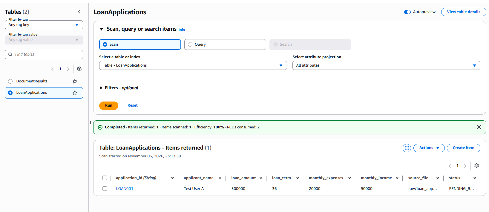
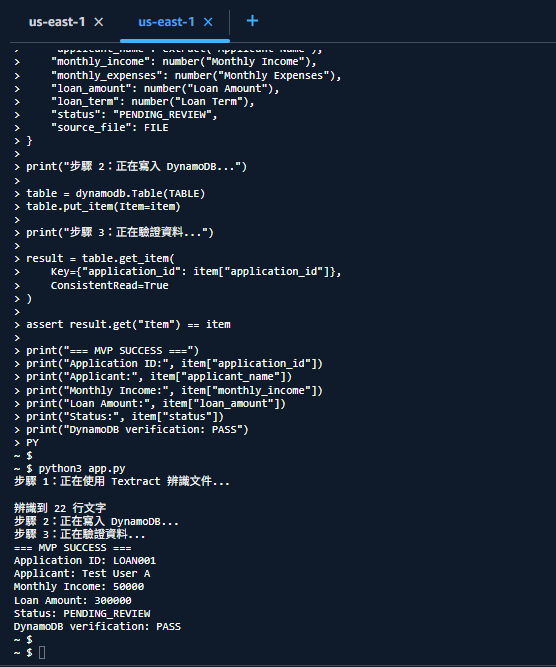
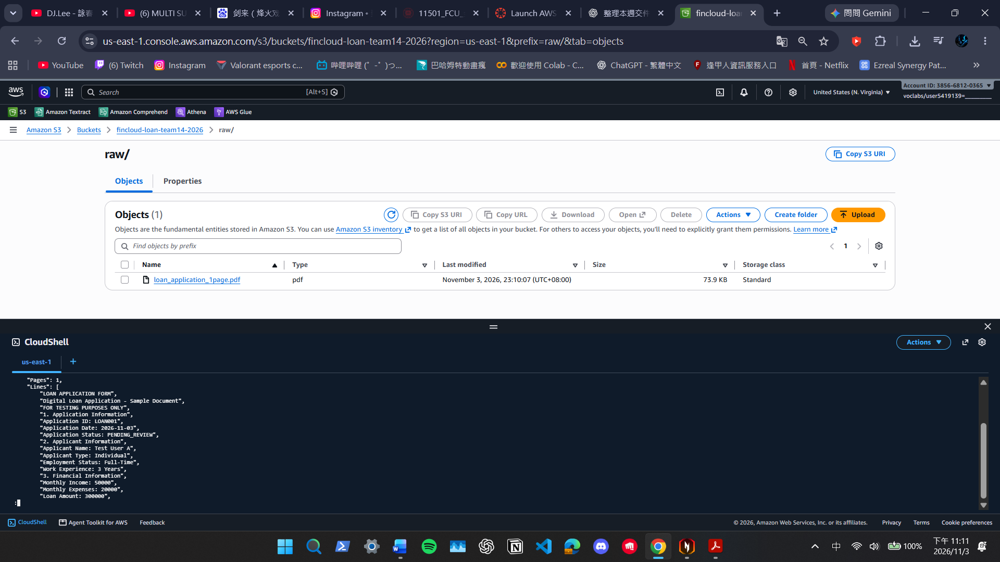
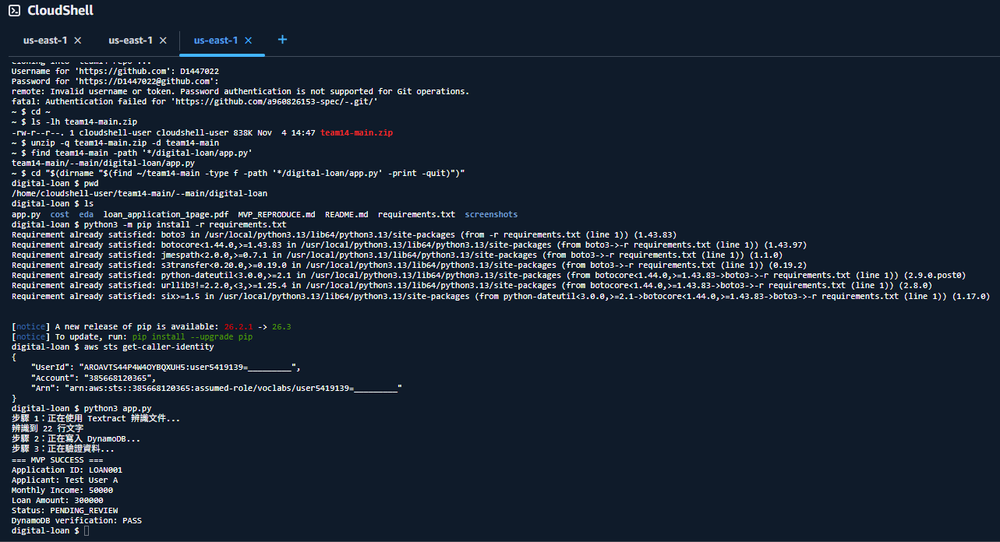

# 第 14 組數位申貸專題｜AWS MVP 重現操作與驗證紀錄

## 1. 專題介紹

本專題以「國泰數位申貸文件自動化處理系統」為研究主題，使用 AWS 雲端服務建立數位申貸 MVP（Minimum Viable Product，最小可行產品）。

系統透過 Amazon S3 儲存申貸文件，使用 Amazon Textract 進行文件文字辨識，再由 Python 程式整理申貸欄位，最後寫入 Amazon DynamoDB 建立案件紀錄。

本專題使用完全虛構的測試資料，不包含真實客戶個資或金融帳戶資訊。

### MVP 已驗證流程

```text
模擬申貸 PDF
     ↓
Amazon S3
     ↓
AWS CloudShell / Python
     ↓
Amazon Textract
     ↓
Python 欄位擷取與資料整理
     ↓
Amazon DynamoDB
     ↓
案件資料讀回與驗證
     ↓
MVP SUCCESS / PASS
```

目前已完成單筆申貸文件的端到端處理，S3 事件觸發、Lambda 自動執行及人工覆核介面為後續規劃。

---

## 2. AWS 執行環境

| 項目 | 設定內容 |
|---|---|
| AWS 環境 | AWS Learner Lab |
| AWS Region | us-east-1 |
| 執行工具 | AWS CloudShell |
| 程式語言 | Python 3 |
| AWS SDK | boto3 |
| 文件儲存服務 | Amazon S3 |
| 文件辨識服務 | Amazon Textract |
| 資料庫服務 | Amazon DynamoDB |
| S3 Bucket | fincloud-loan-team14-2026 |
| S3 物件路徑 | raw/loan_application_1page.pdf |
| DynamoDB Table | LoanApplications |
| DynamoDB 主鍵 | application_id |
| 測試案件編號 | LOAN001 |

### 執行前必要條件

執行者須具有 AWS Learner Lab 存取權限，並確認：

1. S3 Bucket 已建立。
2. 模擬申貸 PDF 已上傳至指定 S3 路徑。
3. DynamoDB 的 LoanApplications 資料表已建立，且主鍵為 application_id（String）。
4. AWS 執行身分具有必要的 S3 讀取、Textract 文件分析及 DynamoDB 讀寫權限。
5. AWS Region 設定為 us-east-1。

本次重現使用既有 AWS 資源，並非從空白 AWS 帳戶自動部署完整基礎設施。

---

## 3. GitHub 專案檔案結構

專題 GitHub Repository：

https://github.com/a960826153-spec/-

數位申貸專題資料夾：

`digital-loan/`

主要檔案結構：

```text
digital-loan/
│
├── README.md
├── MVP_REPRODUCE.md
├── app.py
├── requirements.txt
├── loan_application_1page.pdf
│
├── screenshots/
│   ├── 01_s3_upload.png
│   ├── 02_textract_success.png
│   ├── 03_dynamodb_result.png
│   └── 04_github_reproduce_success.png
│
├── eda/
│   ├── simulated_loan_data.csv
│   ├── data_quality_report.csv
│   ├── loan_eda.ipynb
│   ├── 01_loan_amount_distribution.png
│   ├── 02_income_vs_loan.png
│   └── 03_document_completeness.png
│
└── cost/
    ├── README.md
    └── aws_cost_estimate.png
```

註：`04_github_reproduce_success.png` 為本次新增的重現測試截圖，須於正式繳交前確認已上傳。

---

## 4. GitHub main 程式取得方式

### 4.1 使用 GitHub 下載 ZIP

由於本專題 Repository 設為 Private，直接使用 HTTPS 執行 git clone 時，需要額外進行 GitHub 身分驗證。

為避免使用個人密碼或在 CloudShell 中暴露存取憑證，本次採用 GitHub 網頁下載 main 分支 ZIP 的方式取得程式。

操作步驟：

1. 登入具有 Repository 存取權限的 GitHub 帳號。
2. 進入第 14 組 Repository。
3. 確認目前分支為 main。
4. 點選 Code。
5. 點選 Download ZIP。
6. 將下載的 ZIP 命名為 `team14-main.zip`。
7. 進入 AWS CloudShell。
8. 使用 Actions → Upload file 將 ZIP 上傳至 CloudShell。

### 4.2 在 CloudShell 解壓縮

執行以下指令：

```bash
cd ~

ls -lh team14-main.zip

unzip -q team14-main.zip -d team14-main

find team14-main -path '*/digital-loan/app.py'
```

找到 app.py 後，使用以下指令切換至程式所在目錄：

```bash
cd "$(dirname "$(find ~/team14-main -type f -path '*/digital-loan/app.py' -print -quit)")"

pwd

ls
```

此時應可看到：

- app.py
- requirements.txt
- README.md
- MVP_REPRODUCE.md
- loan_application_1page.pdf

本次下載方式可驗證 main 分支的程式內容，但 ZIP 不包含 Git 提交歷史，因此不等同於 git clone 成功。

---

## 5. 安裝 Python 套件

進入 `digital-loan` 目錄後，執行：

```bash
python3 -m pip install -r requirements.txt
```

目前程式主要使用：

- boto3：操作 AWS Textract 與 DynamoDB。
- re：Python 內建正規表示式模組。

若 boto3 已經安裝，系統可能顯示：

```text
Requirement already satisfied
```

此訊息表示套件已存在，並非執行錯誤。

---

## 6. 確認 AWS 身分與資源

### 6.1 確認 AWS 身分

```bash
aws sts get-caller-identity
```

若能正常取得授權身分資訊，表示目前 AWS CLI 已有可使用的身分。

執行時不需要將 Access Key、Secret Key 或 Session Token 寫入 GitHub。

### 6.2 確認 S3 文件存在

```bash
aws s3 ls s3://fincloud-loan-team14-2026/raw/loan_application_1page.pdf
```

應能找到測試文件：

```text
loan_application_1page.pdf
```

### 6.3 確認 DynamoDB 資料表

```bash
aws dynamodb describe-table \
  --table-name LoanApplications \
  --region us-east-1 \
  --query 'Table.TableStatus'
```

正常情況下，應顯示：

```text
ACTIVE
```

以上檢查用於確認程式執行所需的 AWS 資源已存在。

---

## 7. 執行 AWS MVP

在包含 app.py 的目錄中執行：

```bash
python3 app.py
```

程式將依序進行以下操作：

### 步驟一：文件辨識

Python 使用 boto3 呼叫 Amazon Textract 的 AnalyzeDocument API，並設定：

```python
FeatureTypes=["FORMS"]
```

從 S3 取得模擬申貸 PDF，辨識文件中的文字及表單資訊。

### 步驟二：欄位擷取

Python 使用正規表示式，從 Textract 回傳的文字擷取下列欄位：

- Application ID
- Applicant Name
- Monthly Income
- Monthly Expenses
- Loan Amount
- Loan Term

程式將金額及貸款期限轉換為整數，並設定案件狀態為 PENDING_REVIEW。

### 步驟三：DynamoDB 案件建檔

程式將結構化申貸資料寫入 LoanApplications 資料表。

### 步驟四：讀回驗證

程式使用 application_id 查詢剛才建立的案件，並比對讀回資料與寫入資料是否一致。

若比對成功，程式會顯示：

```text
DynamoDB verification: PASS
```

注意：目前程式使用 `put_item()`，重新執行相同測試案件時，可能覆寫相同主鍵的原有資料。正式系統應增加重複案件檢查與條件式寫入機制。

---

## 8. 實際重現測試紀錄

### 測試日期

2026 年 11 月 4 日

### 測試方式

本組從 GitHub main 分支下載 ZIP，將其上傳至 AWS Learner Lab CloudShell，解壓縮後安裝所需套件，並重新執行 `app.py`。

### 測試環境

- AWS Region：us-east-1
- AWS 執行環境：Learner Lab CloudShell
- 程式來源：GitHub main 分支 ZIP
- 使用既有 S3 Bucket 與 DynamoDB 資料表

### 實際執行結果

```text
步驟 1：正在使用 Textract 辨識文件...
辨識到 22 行文字

步驟 2：正在寫入 DynamoDB...

步驟 3：正在驗證資料...

=== MVP SUCCESS ===
Application ID: LOAN001
Applicant: Test User A
Monthly Income: 50000
Loan Amount: 300000
Status: PENDING_REVIEW
DynamoDB verification: PASS
```

### 測試結果彙整

| 驗證項目 | 實際結果 | 判定 |
|---|---|---|
| GitHub main ZIP 取得 | 成功 | PASS |
| ZIP 解壓縮 | 成功 | PASS |
| boto3 套件檢查 | 成功 | PASS |
| AWS 身分驗證 | 成功 | PASS |
| Textract 文件辨識 | 22 行文字 | PASS |
| 申貸欄位擷取 | LOAN001 | PASS |
| DynamoDB 案件寫入 | 成功 | PASS |
| DynamoDB 案件讀回 | 成功 | PASS |
| 整體 MVP 執行 | MVP SUCCESS | PASS |

### 測試結論

本次成功從 GitHub main 分支取得數位申貸程式，並於既有 AWS Learner Lab 資源環境中重新執行。

測試證明目前 MVP 具備單筆模擬申貸文件辨識、欄位擷取、案件建檔與資料庫讀回驗證的端到端功能。

---

## 9. AWS MVP 截圖證據

### 證據一：S3 文件上傳

檔案：`screenshots/01_s3_upload.png`



說明：模擬申貸 PDF 已成功儲存至 Amazon S3。

### 證據二：Textract 與 Python 執行

檔案：`screenshots/02_textract_success.png`



說明：CloudShell 成功執行 Textract 辨識與 Python 程式，輸出 MVP SUCCESS。

### 證據三：DynamoDB 案件紀錄

檔案：`screenshots/03_dynamodb_result.png`



說明：LoanApplications 資料表成功儲存 LOAN001 案件。

### 證據四：GitHub main 重現測試

檔案：`screenshots/04_github_reproduce_success.png`



說明：2026 年 11 月 4 日從 GitHub main ZIP 取得程式後，在 CloudShell 重新執行並取得 DynamoDB verification: PASS。

---

## 10. MVP 限制與後續改善

本次為教學環境的單筆文件功能驗證，尚未包含完整正式金融服務的安全性、可用性或效能保證。

目前尚未實作：

1. S3 事件觸發與 AWS Lambda 自動處理。
2. 多種文件格式及大量文件批次測試。
3. Textract 信心分數與人工覆核分流。
4. 文件缺漏自動補件通知。
5. 完整金融個資保護、IAM 最小權限及稽核治理驗證。
6. 正式環境的自動化部署。
7. 自動核貸決策功能。

後續將優先改善資料品質檢核、文件辨識例外處理、事件驅動流程及人工覆核機制。

---

## 11. 最終驗證結論

第 14 組數位申貸 AWS MVP 已完成以下技術驗證：

- Amazon S3 成功儲存單頁模擬申貸文件。
- Amazon Textract 成功辨識 22 行文字。
- Python 成功擷取申貸主要欄位。
- Amazon DynamoDB 成功建立 LOAN001 案件。
- DynamoDB 資料讀回驗證 PASS。
- 2026 年 11 月 4 日成功使用 GitHub main ZIP 於既有 AWS Learner Lab 環境重新執行。

**最終結果：MVP SUCCESS / DynamoDB verification: PASS**

本次成果證明數位申貸文件辨識與案件建檔原型具備初步技術可行性，可作為後續自動化與正式環境治理設計的基礎。

本次測試不代表已完成全新 AWS 環境部署、正式金融系統建置或實際授信決策。
