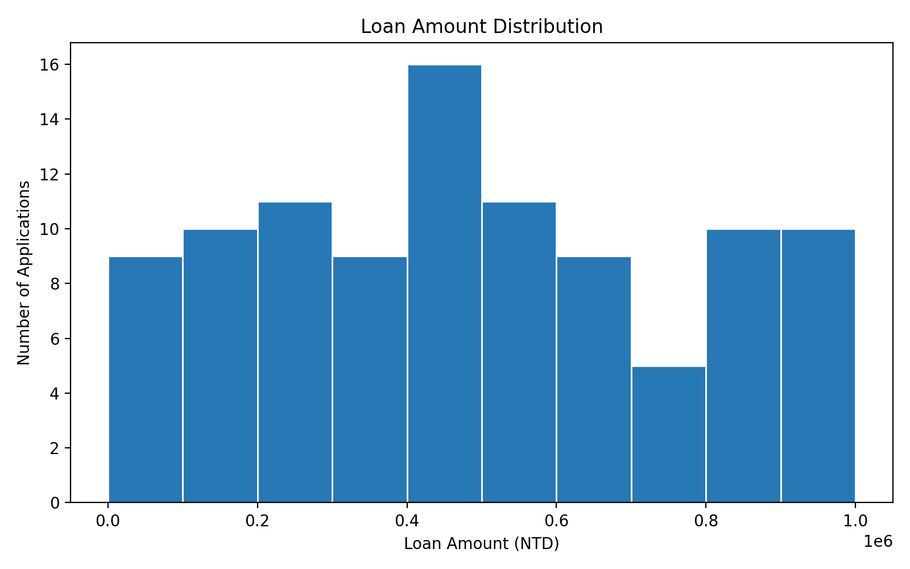
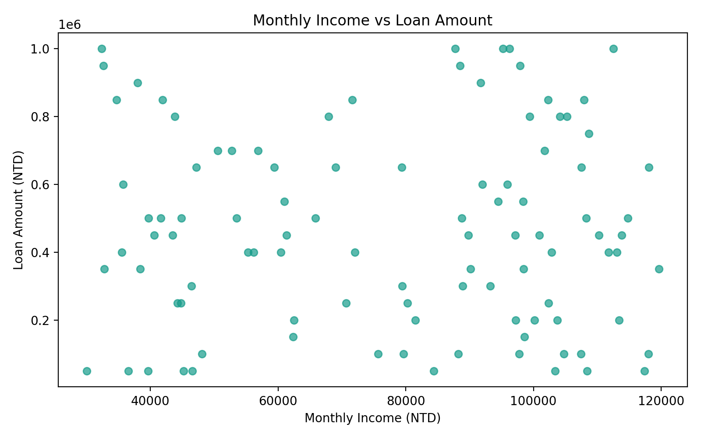
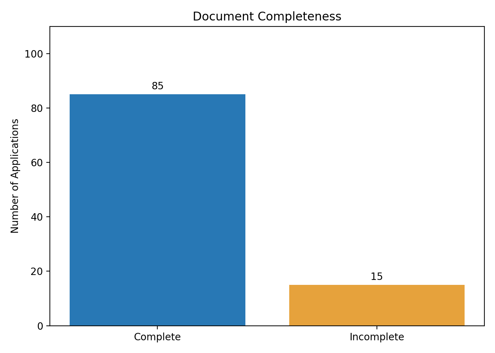
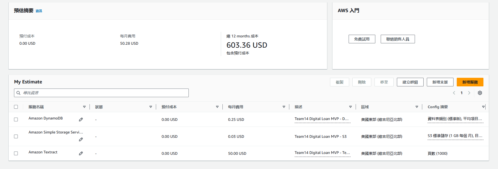

# 金融上雲實務｜第 14 組數位申貸專題

## 1. 專題介紹

### 專題名稱

國泰金控－數位申貸文件自動化處理系統

### 問題與動機

傳統申貸流程需要人工閱讀申請書、輸入申請人資料及建立案件紀錄，不僅耗費時間，也可能因人工輸入而產生錯誤。

本專題以國泰金控數位申貸為課程研究情境，運用 AWS 雲端服務建立數位申貸文件自動化處理原型，透過文件儲存、文字辨識及資料庫管理，減少人工輸入作業。

本專題為課程實作原型，非國泰金控正式上線系統。

### Product Goal

建立一套能夠自動擷取申貸文件資料、建立案件紀錄並支援追蹤處理狀態的雲端原型，提升申貸資料處理效率與準確性。

### 期中 MVP 目標

完成數位申貸流程的第一階段：

**申貸 PDF → Amazon S3 → Amazon Textract → Python → Amazon DynamoDB**

目前已完成單筆文件的端到端測試。

現階段由 Python 手動啟動流程，尚未實作前端申貸網站、S3 事件自動觸發或正式授信決策功能。

---

## 2. AWS 系統架構

### 使用服務

| AWS 服務 | 主要用途 | 實作狀態 |
|---|---|---|
| Amazon S3 | 儲存模擬申貸 PDF | 已實作 |
| Amazon Textract | 辨識文件文字及表單欄位 | 已實作 |
| AWS CloudShell | 執行 Python 處理程式 | 已實作 |
| Amazon DynamoDB | 建立及儲存申貸案件紀錄 | 已實作 |
| AWS Lambda | 文件上傳後自動觸發 | 後續規劃 |
| AWS CloudTrail | 完整稽核治理設計 | 後續規劃 |

### 資料處理流程

1. 使用者手動將模擬申貸 PDF 上傳至 Amazon S3。
2. 在 AWS CloudShell 執行 Python 程式。
3. Python 透過 boto3 呼叫 Amazon Textract AnalyzeDocument API。
4. Textract 分析 PDF，回傳文件文字及表單辨識結果。
5. Python 擷取案件編號、姓名、月收入、月支出、申貸金額及貸款期限。
6. 將欄位整理後寫入 Amazon DynamoDB。
7. 系統將測試案件狀態設定為 `PENDING_REVIEW`。
8. 從 DynamoDB 讀回資料並進行一致性驗證。

### 資料分層設計

- **Raw：** Amazon S3 保存原始申貸 PDF。
- **Processed：** Python 執行期間進行文字擷取與欄位整理。
- **Curated：** Amazon DynamoDB 保存結構化案件資料。

Processed 目前屬程式執行階段，尚未建立獨立的持久化資料層。

### 系統目前範圍

已完成：

- S3 文件上傳與儲存。
- Textract API 文件辨識。
- Python 欄位整理與數值格式檢查。
- DynamoDB 案件建立。
- DynamoDB 案件讀回驗證。
- GitHub main 分支程式重現測試。

尚未完成：

- 前端申貸網站。
- S3 事件自動觸發。
- Lambda 自動執行。
- 人工覆核操作介面。
- 正式授信與核貸模型。
- 完整金融資料治理與稽核系統。
- 正式環境部署。

---

## 3. AWS 環境設定

### 基本資訊

| 項目 | 設定 |
|---|---|
| AWS 環境 | AWS Learner Lab |
| AWS Region | us-east-1 |
| S3 Bucket | fincloud-loan-team14-2026 |
| S3 Object Key | raw/loan_application_1page.pdf |
| DynamoDB Table | LoanApplications |
| Partition Key | application_id |
| Partition Key Type | String |
| 程式語言 | Python 3 |
| AWS SDK | boto3 |

以上為本組已測試成功的教學環境設定。

### Amazon S3 設定

測試文件儲存位置：

`s3://fincloud-loan-team14-2026/raw/loan_application_1page.pdf`

正式系統應採用：

- Block all public access。
- 伺服器端加密。
- 適當的 IAM 存取權限。
- 文件保留與刪除政策。

以上為安全設計要求，不代表所有正式治理措施均已完成驗證。

### Amazon DynamoDB 設定

資料表：`LoanApplications`

主鍵名稱：`application_id`

主鍵型別：String

測試案件：`LOAN001`

測試狀態：`PENDING_REVIEW`

此狀態代表案件等待人工審核，不表示貸款已核准。

---

## 4. GitHub 專案結構

本組正式數位申貸專題統一放在 `main/digital-loan/`，與課堂練習用的保險理賠 EDA 範例分開管理。

### Repository

https://github.com/a960826153-spec/-

### 專題資料夾

`digital-loan/`

### 主要檔案結構

```text
digital-loan/
├── README.md
├── MVP_REPRODUCE.md
├── app.py
├── requirements.txt
├── loan_application_1page.pdf
│
├── cost/
│   ├── README.md
│   └── aws_cost_estimate.png
│
├── eda/
│   ├── simulated_loan_data.csv
│   ├── data_quality_report.csv
│   ├── loan_eda.ipynb
│   ├── 01_loan_amount_distribution.png
│   ├── 02_income_vs_loan.png
│   └── 03_document_completeness.png
│
└── screenshots/
    ├── 01_s3_upload.png
    ├── 02_textract_success.png
    ├── 03_dynamodb_result.png
    └── 04_github_reproduce_success.png
```

註：第四張重現截圖須於正式繳交前確認已上傳。

### 主要檔案用途

| 檔案或資料夾 | 用途 |
|---|---|
| README.md | 專題介紹與管理資訊 |
| MVP_REPRODUCE.md | AWS MVP 重現與驗證說明 |
| app.py | Textract 辨識與 DynamoDB 寫入程式 |
| requirements.txt | Python 套件清單 |
| loan_application_1page.pdf | 虛構申貸測試文件 |
| screenshots/ | AWS 實作及重現測試截圖 |
| eda/ | 模擬資料、品質診斷與分析圖 |
| cost/ | AWS 成本估算與證據 |

---

## 5. MVP 重現操作步驟

### 執行前準備

使用已授權的 AWS Learner Lab 或其他 AWS 帳戶。

執行環境應具備：

- S3 物件讀取權限。
- Textract AnalyzeDocument 權限。
- DynamoDB 資料讀寫權限。
- 已建立的 S3 Bucket、測試 PDF 及 DynamoDB 資料表。

### 取得 GitHub main 程式

本 Repository 為 Private，執行者須具有存取權限。

本組於 2026 年 11 月 4 日採用 GitHub main ZIP 下載方式完成重現測試。

操作方式：

1. 登入具有權限的 GitHub 帳號。
2. 進入 Repository。
3. 確認分支為 main。
4. 點選 Code → Download ZIP。
5. 將 ZIP 命名為 `team14-main.zip`。
6. 使用 AWS CloudShell 的 Actions → Upload file 上傳 ZIP。

### 在 CloudShell 解壓縮

```bash
cd ~

unzip -q team14-main.zip -d team14-main

find team14-main -path '*/digital-loan/app.py'
```

切換至程式資料夾：

```bash
cd "$(dirname "$(find ~/team14-main -type f -path '*/digital-loan/app.py' -print -quit)")"
```

### 安裝必要套件

```bash
python3 -m pip install -r requirements.txt
```

### 確認 AWS 身分

```bash
aws sts get-caller-identity
```

### 確認 S3 文件

```bash
aws s3 ls s3://fincloud-loan-team14-2026/raw/loan_application_1page.pdf
```

### 確認 DynamoDB 資料表

```bash
aws dynamodb describe-table \
  --table-name LoanApplications \
  --region us-east-1 \
  --query 'Table.TableStatus'
```

正常情況下應顯示 `ACTIVE`。

### 執行 MVP

```bash
python3 app.py
```

成功後將顯示：

```text
=== MVP SUCCESS ===
Application ID: LOAN001
Applicant: Test User A
Monthly Income: 50000
Loan Amount: 300000
Status: PENDING_REVIEW
DynamoDB verification: PASS
```

目前程式使用 `put_item()`，重新執行相同案件時可能覆寫相同主鍵的資料，正式環境應增加重複案件防護。

### 完整操作文件

[MVP 重現操作與驗證紀錄](MVP_REPRODUCE.md)

---

## 6. AWS MVP 實際測試結果

### 原始測試

測試日期：2026 年 11 月 3 日

執行環境：AWS Learner Lab

Region：us-east-1

測試文件：`loan_application_1page.pdf`

所有資料均為虛構資料，不含真實客戶個資。

### 測試結果

| 欄位 | 實際結果 |
|---|---|
| Application ID | LOAN001 |
| Applicant Name | Test User A |
| Monthly Income | 50000 |
| Monthly Expenses | 20000 |
| Loan Amount | 300000 |
| Loan Term | 36 |
| Application Status | PENDING_REVIEW |

### MVP 驗證

- S3：模擬申貸 PDF 上傳成功。
- Textract：成功辨識 22 行文字。
- Python：成功擷取主要申貸欄位。
- DynamoDB：成功建立案件。
- DynamoDB：讀回驗證 PASS。

### GitHub main 重現測試

測試日期：2026 年 11 月 4 日

本組從 GitHub main 分支下載 Repository ZIP，並於 AWS CloudShell 解壓縮、確認 Python 套件及 AWS 身分後，重新執行 `app.py`。

實際執行結果：

```text
步驟 1：正在使用 Textract 辨識文件...
辨識到 22 行文字

步驟 2：正在寫入 DynamoDB...

步驟 3：正在驗證資料...

=== MVP SUCCESS ===
Application ID: LOAN001
Applicant: Test User A
Monthly Income: 50000
Loan Amount: 300000
Status: PENDING_REVIEW
DynamoDB verification: PASS
```

### 測試結論

本組已確認 GitHub main 分支程式能在既有 AWS Learner Lab 資源環境中重新執行，並成功完成單筆申貸文件的端到端功能驗證。

本次使用 ZIP 取得程式，並非 git clone，也不代表已完成全新 AWS 帳戶的自動化部署。

### MVP 成功截圖

- [01｜S3 文件上傳](screenshots/01_s3_upload.png)
- [02｜Textract 執行成功](screenshots/02_textract_success.png)
- [03｜DynamoDB 案件結果](screenshots/03_dynamodb_result.png)

第四張截圖：

`screenshots/04_github_reproduce_success.png`

此檔案用於保存 2026 年 11 月 4 日的 GitHub main 重現測試成功畫面，正式繳交前須確認檔案已存在。

---

## 7. 模擬資料與 EDA 分析

### 資料來源

本組使用 Python NumPy 產生 100 筆虛構申貸案件資料，隨機種子設定為 14，以便重現相同資料。

資料共包含 7 個欄位：

1. application_id：案件編號。
2. monthly_income：月收入。
3. monthly_expenses：月支出。
4. loan_amount：申貸金額。
5. loan_term：貸款期限。
6. work_experience：工作年資。
7. document_complete：文件完整性標記。

### 資料品質檢查

| 項目 | 結果 |
|---|---:|
| 資料總筆數 | 100 |
| 缺失值 | 0 |
| 重複申請編號 | 0 |
| 基本數值檢查異常 | 0 |
| 文件完整標記 | 85 |
| 文件不完整標記 | 15 |

文件完整性為模擬標記，不等於實際 PDF 辨識缺漏率。

### EDA 統計結果

- 平均申貸金額：465,500 元。
- 申貸金額中位數：450,000 元。
- 月收入與申貸金額相關係數：約 -0.02。
- 文件不完整標記比例：15%。

由於資料為隨機模擬產生，以上統計不代表真實金融客戶的申貸行為。

### 三張分析圖

#### 申貸金額分布



#### 月收入與申貸金額關係



#### 文件完整性



### 資料來源檔案

- [模擬申貸資料 CSV](eda/simulated_loan_data.csv)
- [資料品質檢查 CSV](eda/data_quality_report.csv)
- [EDA 分析程式](eda/loan_eda.ipynb)

---

## 8. AWS 成本試算

### 成本估算目的

本專題使用 AWS Pricing Calculator 評估數位申貸 MVP 未來持續處理申貸文件所需的雲端資源成本。

### 使用量假設

估算區域：us-east-1

假設每月處理 1,000 份單頁申貸 PDF。

| 服務 | 使用量假設 |
|---|---|
| Amazon S3 | 1 GB 儲存、1,000 次上傳及 1,000 次讀取 |
| Amazon Textract | 每月 1,000 頁 Forms 文件分析 |
| Amazon DynamoDB | On-demand、1 GB 儲存、1,000 次寫入及 5,000 次讀取 |

### AWS Pricing Calculator 結果

| AWS 服務 | 每月費用 |
|---|---:|
| Amazon S3 | US$0.03 |
| Amazon Textract | US$50.00 |
| Amazon DynamoDB | US$0.25 |
| **總計** | **US$50.28** |

- 每月預估成本：US$50.28。
- 一年預估成本：US$603.36。
- 三年預估成本：US$1,810.08。
- 預付成本：US$0.00。

三年費用假設服務價格及每月使用量不變。

### 官方試算連結

https://calculator.aws/#/estimate?id=48288f1051fa9464aaa020334f22bb4b47da91a1

### 成本試算證據

[成本試算說明](cost/README.md)



本次估算不是 AWS Learner Lab 的實際帳單，尚未包含額外自動化服務、稅金及其他可能產生的費用。

---

## 9. 資料安全、法遵與風險

### 個資保護

本專題僅使用虛構申貸資料，不使用真實客戶姓名、身分證號、銀行帳號或金融交易紀錄。

### AWS 資訊安全規劃

- S3 應限制公開存取。
- 儲存資料應啟用加密。
- 不在 GitHub 保存 AWS Access Key 或 Secret Key。
- 正式環境採最小權限原則。
- 建立適當的使用者權限及稽核機制。
- 不由原型系統直接進行核貸決策。
- 辨識不確定的案件應交由人工確認。

### 五項主要風險

| 風險 | 影響 | 因應方式 |
|---|---|---|
| Textract 辨識錯誤 | 申貸資料可能不正確 | 欄位檢查與人工覆核 |
| 文件或資料不完整 | 增加補件工作 | 必填欄位檢查及待補件狀態 |
| 個人資料外洩 | 影響資訊安全 | 私有存取、加密與最小權限 |
| AWS 權限或額度限制 | 影響系統執行 | 確認服務權限並控管資源 |
| 案件寫入失敗或重複 | 影響資料正確性 | 主鍵檢查、寫入驗證及重複案件防護 |

以上措施部分已於原型中進行基本驗證，其餘仍屬後續規劃。

### 後續金融法遵規劃

正式金融環境須另外評估：

- 個人資料保護。
- 金管會委外相關規範。
- 資料落地與跨境傳輸。
- 資料保留期限。
- IAM 最小權限。
- 稽核軌跡。
- 金融服務退場與資料刪除機制。
- 人工覆核與責任歸屬。

本次為課程原型，不代表已完成正式金融服務之法遵驗證。

---

## 10. Scrum 專案管理

### 團隊角色

| 角色 | 負責組員 |
|---|---|
| Product Owner | 待組內確認 |
| Scrum Master | 待組內確認 |
| AWS MVP 開發 | 待組內確認 |
| 資料分析與品質檢查 | 待組內確認 |
| 文件與簡報整合 | 待組內確認 |

正式繳交前應填入實際組員姓名與工作分工。

### Product Backlog

本組已建立 8 則數位申貸專題 User Story，使用 GitHub Issues 保存工作需求、驗收條件、優先級、建議估點與實作證據。

| 編號 | Issue | 工作內容 |
|---|---|---|
| DL-01 | #5 | S3 申貸 PDF 上傳 |
| DL-02 | #6 | Textract 文件辨識 |
| DL-03 | #7 | DynamoDB 案件建檔與驗證 |
| DL-04 | #8 | AWS MVP 程式與截圖整理 |
| DL-05 | #9 | 100 筆模擬申貸資料 |
| DL-06 | #10 | EDA 分析圖與洞察 |
| DL-07 | #11 | 資料品質診斷 |
| DL-08 | #12 | AWS 成本試算與風險文件 |

### GitHub Issues

https://github.com/a960826153-spec/-/issues

### GitHub Projects

專案名稱：

`Team14 - Digital Loan Scrum Board`

看板連結：待 Repository 擁有者建立或確認。

### Scrum 狀態說明

以上 8 則 Issues 為期中成果整理時補建的 Product Backlog 紀錄，不代表它們在 Sprint 1–2 開始時就已存在。

Story Points 為建議估點，正式數值及 Must／Should／Could 優先級仍須依團隊確認。

### Sprint 規劃

| Sprint | 規劃目標 |
|---|---|
| Sprint 1 | 問題定義、需求與資料規劃 |
| Sprint 2 | AWS MVP 與期中成果整理 |
| Sprint 3 | 資料品質與欄位檢核 |
| Sprint 4 | 自動化、補件及人工覆核 |
| Sprint 5 | 整合測試與期末展示 |

此表為規劃方向，實際 Sprint 1–2 完成情況應以原始會議紀錄、工作表與 GitHub 提交紀錄為準。

### 期中已驗證 Increment

- 模擬申貸 PDF 上傳 S3。
- Textract 文件辨識。
- Python 欄位整理。
- DynamoDB 案件建立與讀回。
- 100 筆模擬資料與 EDA 分析。
- AWS 成本試算與風險文件初稿。
- GitHub main ZIP 重現測試。

### 待補 Scrum 證據

- Sprint 1–2 Burndown Chart。
- Sprint 1–2 Review 與 Retro 紀錄。
- 業師回饋及 Backlog 調整紀錄。
- Pull Request 與程式碼審查紀錄。
- 確認組員分工、負責人及 Projects 看板連結。

燃盡圖應依據可查證的歷史進度製作，不以補建 Issues 的日期冒充過去 Sprint 的執行紀錄。

---

## 11. AI 使用聲明

本專題使用生成式 AI 工具協助開發與文件整理。

### ChatGPT 輔助內容

1. AWS MVP 實作步驟規劃。
2. Python 程式撰寫與檢查。
3. AWS Textract 與 GitHub 操作問題排查。
4. README 與 MVP 重現文件整理。
5. EDA 分析結果的文字說明。
6. AWS 成本試算及風險文件整理。

### Codex 輔助內容

組員使用 Codex 協助期中提案簡報之內容修訂、版面調整與 PowerPoint 檔案產出。

### 人工驗證

- AWS 資源建立由組員操作。
- S3 文件上傳由組員執行。
- Textract 文件辨識由組員驗證。
- DynamoDB 案件建檔與讀回由組員確認。
- GitHub main ZIP 重現測試由組員實際執行。
- 成本試算由組員使用 AWS Pricing Calculator 完成。
- 資料分析及簡報成果須經組員確認。

本專題不使用真實金融客戶資料，也不將未經驗證的 AI 產出視為實際測試成果。

---

## 12. 後續改進方向

本次期中 MVP 已完成數位申貸流程的第一段，後續可擴充：

1. 使用 AWS Lambda 自動處理新上傳的申貸文件。
2. 建立申貸文件上傳網站。
3. 增加文件必要欄位及合理性檢查。
4. 建立申貸案件查詢與狀態追蹤功能。
5. 增加 Textract 信心分數檢查。
6. 建立人工覆核及補件流程。
7. 加強 IAM 權限管理及稽核紀錄。
8. 進行大量資料、不同文件格式及效能測試。
9. 建立重複案件防護與錯誤重試機制。
10. 評估正式金融系統的部署、安全與法遵要求。

---

## 13. 專題成果總結

本組運用 Amazon S3、Amazon Textract、Python 與 Amazon DynamoDB，成功完成數位申貸文件辨識與案件建檔的最小可行原型。

### 目前主要成果

- 完成 AWS MVP 單筆文件端到端測試。
- Textract 成功辨識 22 行文字。
- DynamoDB 成功建立 LOAN001。
- DynamoDB 讀回驗證 PASS。
- 2026 年 11 月 4 日完成 GitHub main ZIP 重現測試。
- 完成 100 筆虛構申貸資料分析。
- 完成三張 EDA 圖表與資料品質檢查。
- 完成 AWS 成本估算：US$50.28／月。
- 建立 8 則 GitHub Product Backlog Issues。

### 最終結論

本次成果證明 AWS 雲端服務可整合完成申貸文件的文字辨識、欄位擷取與案件資料儲存。

目前已具備初步技術可行性，未來將持續改善資料品質、流程自動化、人工覆核及金融治理機制。

本專題為課程教學原型，未涉及真實客戶資料、實際核貸決策或正式金融系統上線。
